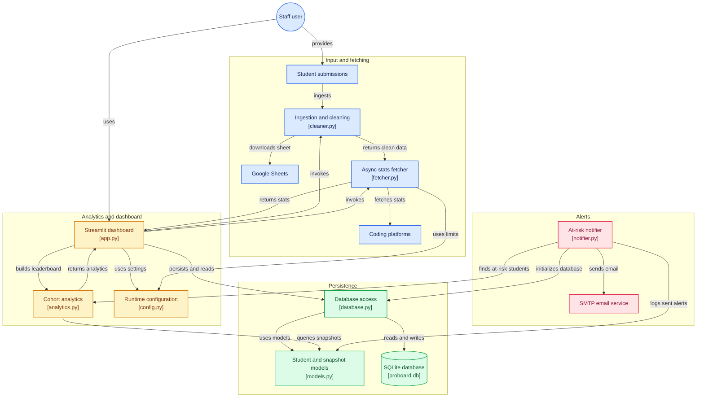

# PROBOARD 🚀

I built PROBOARD because manually tracking coding progress for a large batch of students (130+ in this case) across different competitive programming platforms is a massive headache. Nobody wants to click through a hundred LeetCode and HackerRank profiles every week just to see who solved what. 

PROBOARD is a live, automated analytics dashboard that takes a Google Sheet (or CSV/Excel upload) of student profile links, securely fetches their real-time stats, and visualizes the data to help identify who is doing well and who needs a push.

**Live Demo:** [https://proboard.streamlit.app](https://proboard.streamlit.app)


https://github.com/user-attachments/assets/db630358-701a-4f9e-8e9a-d415e82b7f53


---

## 🛠️ The Tech Stack

I kept the stack relatively lightweight but robust enough to handle data ingestion, asynchronous API calls, and caching.

* **Frontend / UI:** [Streamlit](https://streamlit.io/) (with some custom CSS injections to make the sidebar and metrics look a bit more polished than the default theme).
* **Data Manipulation:** `pandas` and `numpy`.
* **API Fetching:** `aiohttp` and `asyncio` (Crucial for speed and rate-limiting).
* **Database / ORM:** SQLite mapped with `SQLAlchemy`.
* **Visualizations:** `plotly`.

---




## 🧠 How It Actually Works (The Walkthrough)

If you're looking through the code, here is a breakdown of how the data flows through the app. 

### 1. Data Ingestion & Cleaning (`cleaner.py`)
The app accepts either a direct file upload or a public Google Sheet URL. 
Students are notorious for pasting messy URLs (e.g., adding trailing slashes, random query parameters, or accidentally linking the 'badges' page instead of their main profile). The cleaner script uses regular expressions to strip out HTML/XSS payloads and strictly extracts just the username handle from whatever link they provided.

### 2. The Fetcher Engine (`fetcher.py`)
This was the trickiest part to get right. If you send 200+ requests to LeetCode's GraphQL API and HackerRank's REST API in a split second, they will assume you are a bot doing a DDoS attack and slap you with an HTTP 429 (Too Many Requests) or just ban your IP.

To fix this, I used `aiohttp` with `asyncio.Semaphore` to limit concurrent requests. If the script hits a rate limit, it catches it and applies exponential backoff (waiting a bit longer before trying again) instead of crashing the whole dashboard. It returns zeroes for private or broken profiles instead of throwing unhandled exceptions.

### 3. Database Caching (`database.py` & `models.py`)
We don't want to ping the APIs every single time someone refreshes the Streamlit page. 
Once the fetcher gets the data, SQLAlchemy bulk-upserts it into a local SQLite database (`proboard.db`). It stores the student info and a daily snapshot of their stats (`daily_stats` table). This allows us to calculate things like "7-Day Velocity" (how many problems they solved this week compared to last week).

### 4. The Analytics & Intervention Panel (`analytics.py` & `app.py`)
The main dashboard shows the global leaderboard and Plotly charts breaking down platform affinity (e.g., who prefers LeetCode vs HackerRank). 

My favorite part is the **Intervention Panel**. It filters the dataset to show actionable items:
* **Low Performers:** Students who haven't solved many problems.
* **Missing Profiles:** Students who forgot to submit their links.
* **API Failures:** Profiles that threw an error (usually means they set their LeetCode profile to private, or they typo'd their username).
* **Custom Filter:** A dual-ended slider to dynamically search for students who have solved within a specific range of problems (e.g., 60 to 80 problems).

### 5. Automated Alerts (`notifier.py`)
There is a standalone script that can be hooked up to a cron job. It checks the database for "at-risk" students (e.g., 0 velocity over 7 days) and sends them a polite, automated HTML email via `smtplib` reminding them to practice. It has an idempotency table (`email_log`) so it never accidentally spams a student twice in one day.

---

## 💻 Local Setup

If you want to run this yourself, grab the code and set up a virtual environment.

1. **Clone and install dependencies:**
   ```bash
   git clone <your-repo-link>
   cd proboard
   pip install -r requirements.txt
   ```

2. **Set up environment variables:**
   Create a `.env` file in the root directory. You'll need this for the email notifier and Google Sheets integration.
   ```env
   # .env
   GOOGLE_SHEET_ID=your_sheet_id_here
   HR_WEIGHT=0.5
   SMTP_HOST=smtp.gmail.com
   SMTP_PORT=587
   SMTP_USER=your_email@gmail.com
   SMTP_PASSWORD=your_app_password
   ```

3. **Run the Streamlit App:**
   ```bash
   streamlit run app.py
   ```
   The app will spin up on `http://localhost:8501`. 

4. **Testing the Notifier (Optional):**
   If you want to test the email alerts without actually bothering anyone, use the dry-run flag:
   ```bash
   python notifier.py --dry
   ```

---
*Feel free to poke around the code, fork it, or submit a PR if you find a way to optimize the GraphQL queries further!*
